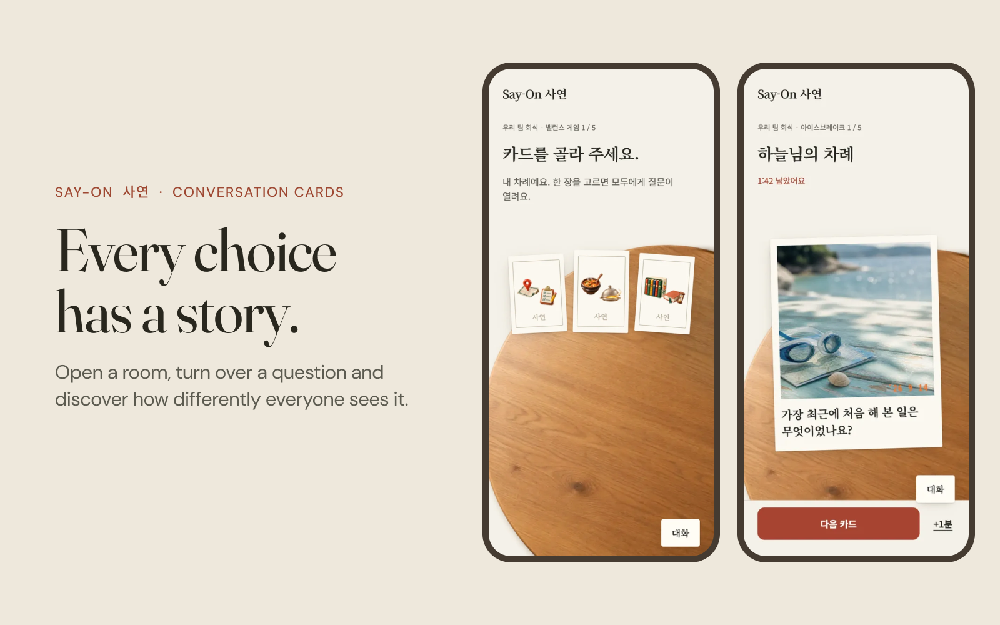
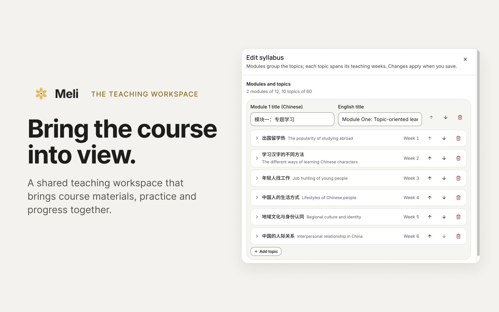
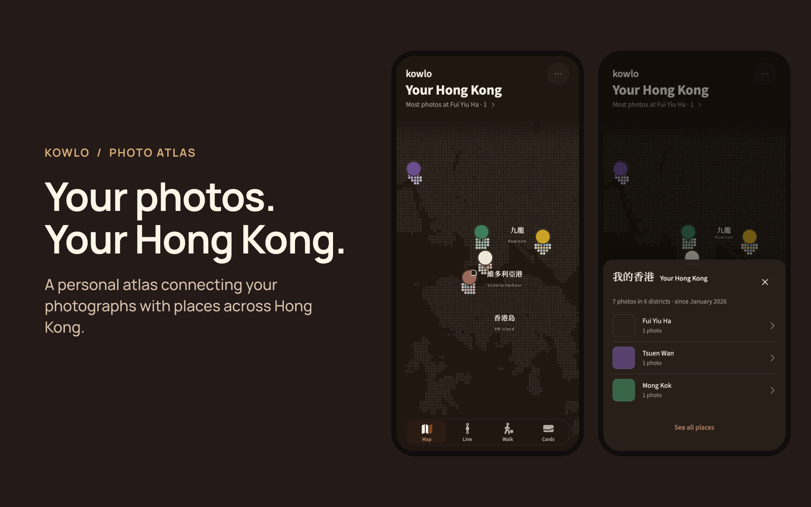

## Eric · Marketing Engineer

**I build the product and the story around it.**

I'm **Eric (Hyunjun Kim)**, studying **Marketing & Information Systems at HKUST**. I start with who a product is for, what it needs to do and why someone would choose it.

On my independent projects, I carry that thinking from research and positioning into product planning, interface design, frontend and backend development, testing and product marketing. I plan the work, build the experience and shape how it reaches people.

I also contribute to language-learning software with **HKUST's Center for Language Education**. **[XiYouQuest](https://github.com/EricEremos/xiyouquest-showcase), a team project I contribute to, won 1st Place at the 2026 HKUST GenAI Hackathon.**

[LinkedIn](https://www.linkedin.com/in/ericmos/) · [All projects & my contributions](work/README.md)

### Selected work

Three examples of how I connect a product's purpose, the experience of using it and the story that introduces it.

### Say-On · Every choice has a story.

A conversation card game for the moment after a choice. Open a room, turn over a question and discover how differently everyone sees it.

**My role:** Independent concept, product planning, interface design, development and product presentation.  
**Try it:** Playable in your browser.

[Play Say-On](https://say-on.vercel.app/) · [Watch the film](https://github.com/EricEremos/say-on-showcase#watch-the-product-film) · [Explore the project](https://github.com/EricEremos/say-on-showcase)

### MELI · Bring the course into view.

A shared teaching workspace that brings course materials, practice and progress together.

**My contribution:** Learning workflows, interface work, backend integration and testing, assessment materials, analysis and university sign-in integration.  
**Access:** A university team project with institutional access; the public showcase explains the work.

[Watch the film](https://github.com/EricEremos/meli-showcase#watch-the-product-film) · [Explore MELI](https://github.com/EricEremos/meli-showcase)

### KOWLO · Your photos. Your Hong Kong.

A personal atlas connecting your photographs with places across Hong Kong, alongside illustrated cards of its stations, landmarks and islands.

**My role:** Independent product direction, design, engineering and showcase development.  
**Status:** In development; explore the current product through its showcase.

[Watch the film](https://github.com/EricEremos/kowlo-showcase#watch-the-product-film) · [Explore KOWLO](https://github.com/EricEremos/kowlo-showcase)

### How I work

I research before committing to a direction, review the full brief and make the proposed experience visible before building. I check the result against its purpose, refine it through feedback and keep useful decisions in a linked knowledge base.

**ChatGPT supports research, planning and building; Claude helps refine the design details and finish the work.** I set the direction, coordinate the process and review the results.

[See the full project collection and my contribution to each](work/README.md).

Away from the screen, I sing in a band.
